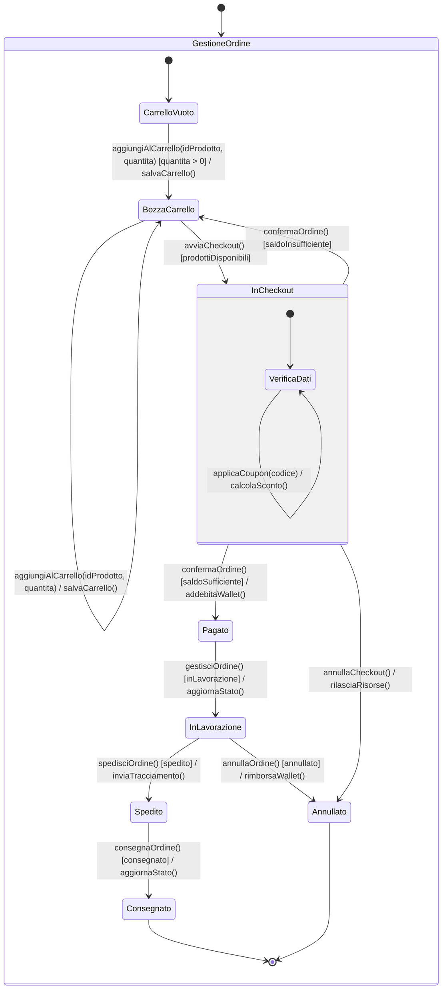
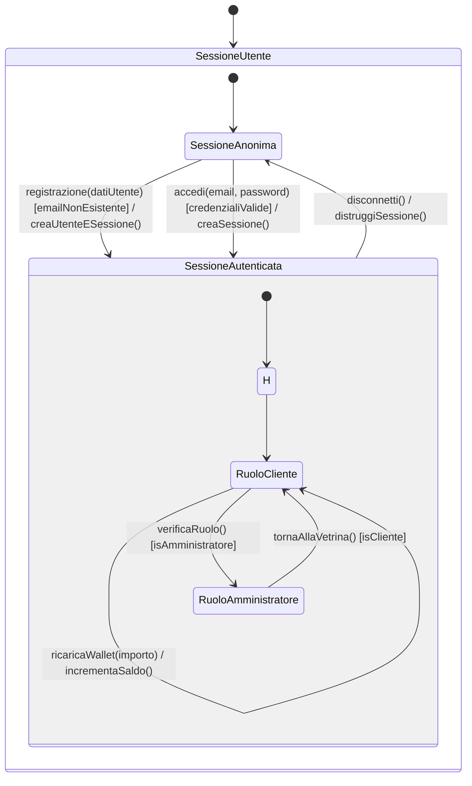
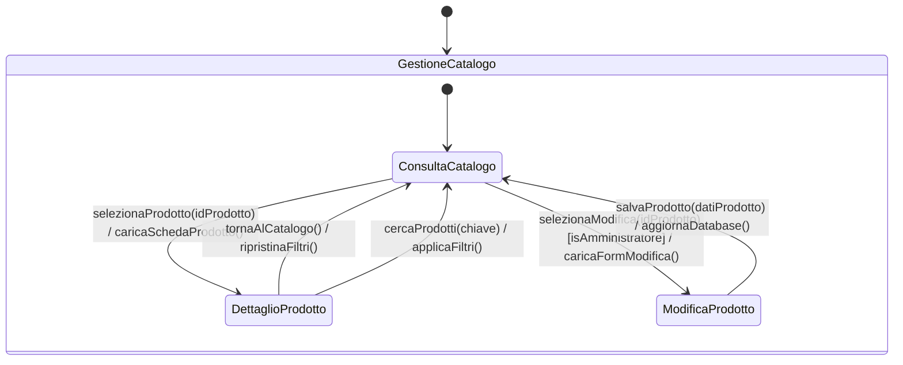
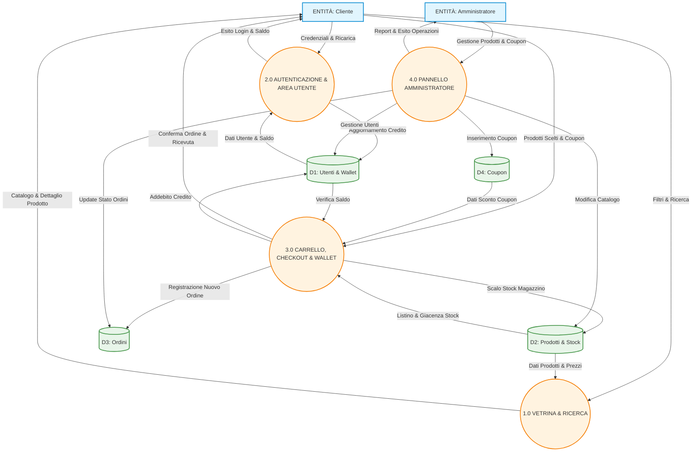
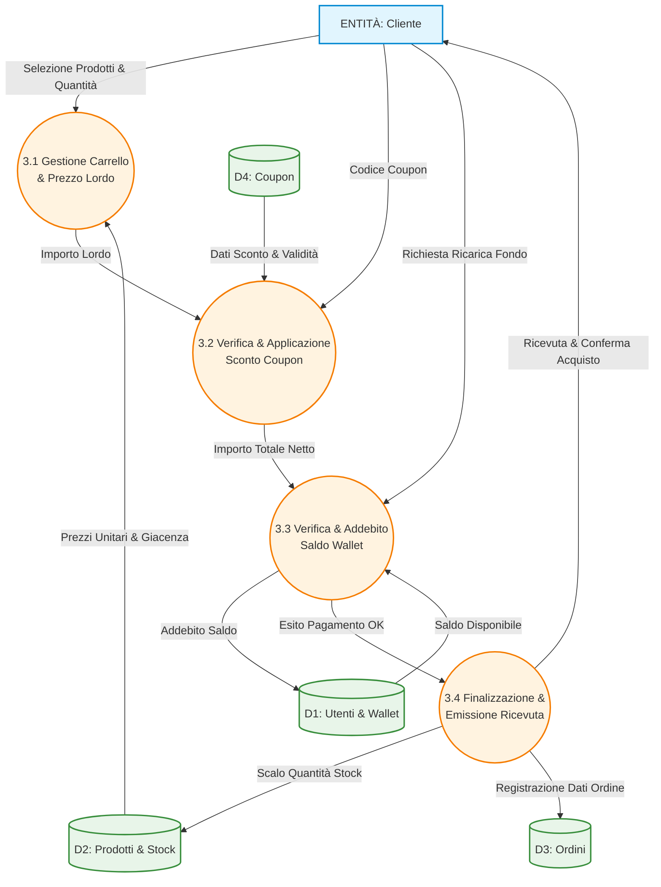
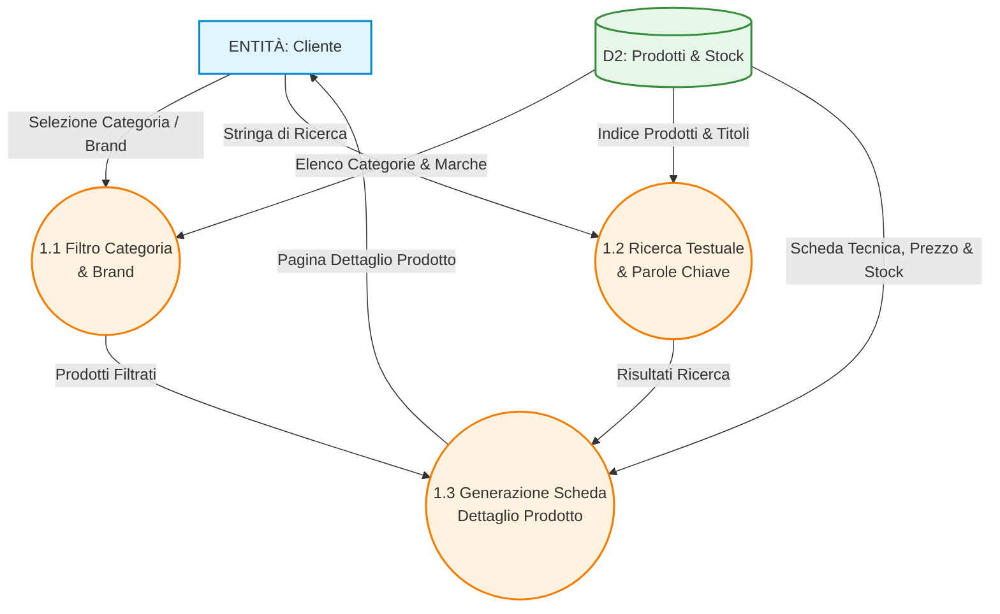
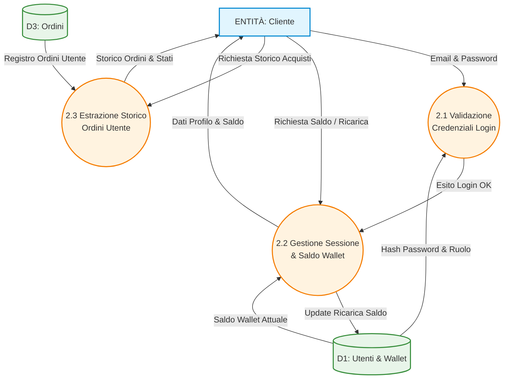
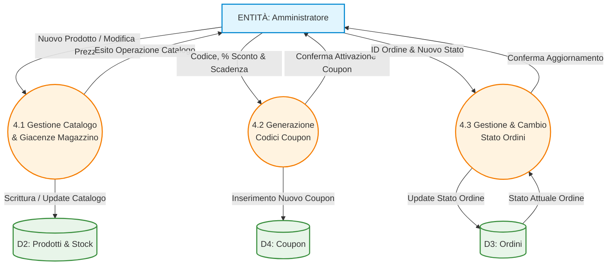

# SPECIFICHE DI PROGETTO — GLAMOURGLOW

> **Progetto per l'esame di Ingegneria del Software Avanzata - Giulia Panarello**  

---

## 1. Introduzione e Obiettivi del Sistema

* **Dominio Applicativo:** Piattaforma e-commerce dedicata alla vendita di prodotti di cosmetica e beauty.
* **Scopo del Sistema:** Offrire un'esperienza d'acquisto completa e intuitiva per i clienti, integrando un sistema di Wallet con ricarica e Coupon promozionali, unita a uno strumento di gestione centralizzato per gli amministratori.
* **Modello Architetturale:** Piattaforma strutturata secondo il pattern Model-View-Controller (MVC) e distribuita in un'architettura monolitica a due livelli, in cui il Web Tier gestisce l'interfaccia e la logica di business, mentre il Data Tier garantisce la persistenza del database, entrambi isolati in container Docker.

---

## 2. Requisiti Funzionali (RF)

### 2.1 Modulo 1: Vetrina, Ricerca & Dettaglio Prodotto
* **RF-1.1 (Homepage & Vetrina):** Il sistema deve visualizzare i prodotti a catalogo organizzandoli in modo chiaro per categoria e marchio.
* **RF-1.2 (Barra di Ricerca e Filtri):** Il sistema deve fornire una barra di ricerca dotata di filtri veloci per la selezione rapida dei prodotti.
* **RF-1.3 (Dettaglio Prodotto):** Il sistema deve mostrare la scheda informativa di ciascun prodotto con descrizione, selezione della quantità desiderata e tasto di inserimento rapido d'acquisto.

### 2.2 Modulo 2: Carrello, Checkout & Wallet
* **RF-2.1 (Carrello e Checkout):** Il sistema deve consentire l'inserimento dei prodotti nel carrello, la consultazione del riepilogo dei costi e la conferma finale dell'acquisto.
* **RF-2.2 (Sconti Coupon):** Il sistema deve permettere l'inserimento di codici promozionali per ricalcolare e scontare il totale dell'ordine.
* **RF-2.3 (Sezione Wallet & Ricarica):** Il sistema deve mettere a disposizione un Wallet per ogni utente e consentire la ricarica rapida del saldo qualora i fondi risultino insufficienti durante il checkout.

### 2.3 Modulo 3: Autenticazione & Area Utente
* **RF-3.1 (Login & Registrazione):** Il sistema deve gestire la registrazione di nuovi clienti e l'autenticazione sicura degli account esistenti.
* **RF-3.2 (Area Personale):** Il sistema deve consentire all'utente di consultare lo storico degli ordini effettuati e gestire i dati del proprio profilo.
* **RF-3.3 (Monitoraggio Credito):** Il sistema deve mostrare in tempo reale il saldo disponibile all'interno del Wallet personale.

### 2.4 Modulo 4: Pannello Amministratore
* **RF-4.1 (Gestione Prodotti):** L'amministratore deve poter eseguire operazioni CRUD (inserimento, modifica, eliminazione) sui prodotti a catalogo.
* **RF-4.2 (Gestione Ordini):** L'amministratore deve poter visualizzare tutti gli ordini ricevuti e modificarne lo stato evolutivo (es. in lavorazione, spedito, consegnato, annullato).
* **RF-4.3 (Gestione Utenti & Coupon):** L'amministratore deve poter amministrare gli account dei clienti e creare nuovi codici sconto Coupon.

---

## 3. Requisiti Non Funzionali (RNF) e Sicurezza

* **RNF-1 (Sicurezza ed Evitamento Vulnerabilità):** Utilizzo obbligatorio di Prepared Statements nel layer DAO per azzerare il rischio di attacchi SQL Injection.
* **RNF-2 (Gestione delle Sessioni):** L'applicazione riconosce l'utente dopo il login e mantiene attiva la sua sessione HTTP in modo sicuro, evitando la perdita del carrello o dell'accesso al profilo durante la navigazione.
* **RNF-3 (Persistenza dei Dati):** Salvataggio permanente delle informazioni su volume dedicato PostgreSQL (`postgres_data`).
* **RNF-4 (Efficienza di Avvio):** Avvio deterministico dell'intero stack applicativo entro 384 ms previa validazione della readiness del database.

---

## 4. Specifiche di Deployment e Infrastruttura Container

* **Architettura a Container Separati:** L'applicazione web (Apache Tomcat 10.1 con Java 17) e il database (PostgreSQL 15) eseguono in due ambienti virtuali Docker separati e isolati.
* **Configurazione Automatica del Database:** Al primo avvio, il database crea automaticamente tutte le tabelle e popola i dati necessari eseguendo lo script `schema.sql`.
* **Avvio Sincronizzato (Zero Race Conditions):** L'applicazione web attende che il database sia completamente avviato e pronto a ricevere connessioni prima di partire (`depends_on: db: condition: service_healthy`), evitando errori di avvio.
* **Rete Interna Dedicata:** La connessione tra applicazione e database avviene tramite una rete virtuale interna sicura, utilizzando l'hostname `db`.

---

## 5. Vincoli Tecnologici e Strumenti Utilizzati

### Stack Tecnologico (Runtime)
* **Backend:** Java 17 / Jakarta EE (Servlet, DAO Pattern, JDBC).
* **Frontend:** JavaServer Pages (JSP), HTML5, CSS3, JavaScript.
* **Web Container:** Apache Tomcat 10.1.
* **Database:** PostgreSQL 15.
* **Containerizzazione:** Docker & Docker Compose per il deployment orchestrato.

### Strumenti di Sviluppo e Modellazione
* **IDE:** IntelliJ IDEA.
* **Controllo Versione:** Git e piattaforma GitHub per il versionamento.
* **Modellazione UML e Statecharts:** Mermaid.js per la generazione dei diagrammi comportamentali e strutturali.

---

## 6. Modellazione Dinamica con Statecharts

### 6.1 Ciclo di Vita dell'Ordine e Checkout

### 6.2 Sessione Utente e Autenticazione

### 6.3 Gestione Catalogo

## 7. Modellazione Dinamica con DFD

### 7.1 DFD DI PRIMO LIVELLO 

### 7.2 DFD di Livello 2 (Raffinamento Checkout & Wallet)

### 7.3 DFD Livello 2 — Vetrina, Ricerca & Dettaglio

### 7.4 DFD Livello 2 — Autenticazione & Area Utente

### 7.5 DFD Livello 2 — Pannello Amministratore
